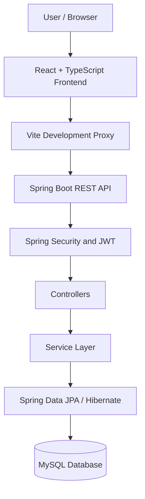

# LUMORA — Library Management System

<p align="center">
  <strong>Your Digital Library.</strong>
</p>

<p align="center">
  A modern, role-based Library Management System built to simplify library operations, book circulation, and digital catalogue management.
</p>

<p align="center">
  
  
  
  
  
  
</p>

---

## About the Project

**LUMORA** is a full-stack Library Management System designed to digitize and streamline everyday library operations.

The application provides dedicated interfaces and role-based functionality for administrators, librarians, and members. It brings book catalogue management, borrowing workflows, return verification, and user administration into one centralized platform.

The project follows a separated frontend and backend architecture, with a React-based user interface communicating with a Spring Boot REST API backed by MySQL.

## Key Features

### Admin Portal
- Role-based user management.
- User activation and deactivation.
- Role management and administrative controls.
- Dashboard metrics and system overview.

### Librarian Portal
- Book catalogue and inventory management.
- CSV-based bulk book import with error reporting.
- Borrow request review and approval.
- Return request verification.
- Loan extension management.

### Member Portal
- Browse and search the book catalogue.
- Submit borrow requests.
- Track active loans and due dates.
- Submit return requests.
- Request loan extensions.
- Manage personal profile information.

## Technology Stack

| Layer | Technologies |
|---|---|
| Frontend | React 19, TypeScript, Vite 8, Tailwind CSS v4 |
| Backend | Java 21, Spring Boot 4.1.1 |
| Database | MySQL 8 |
| Security | Spring Security, JWT, BCrypt |
| Authentication | Access tokens and HttpOnly refresh-token cookies |
| Data Access | Spring Data JPA, Hibernate |
| Build Tools | Maven Wrapper, npm |

## System Architecture

The application follows a client-server architecture.



The frontend communicates with the backend through REST API endpoints. Spring Security handles authentication and authorization, while Spring Data JPA and Hibernate manage database persistence.

## Repository Structure

```text
LUMORA-Library-Management-System/
│
├── library-management-system-backend/
│   ├── src/
│   ├── .mvn/
│   ├── .env.example
│   ├── mvnw
│   ├── mvnw.cmd
│   ├── pom.xml
│   └── README.md
│
├── library-management-system-frontend/
│   └── react-ts/
│       ├── public/
│       ├── src/
│       ├── .env.example
│       ├── package.json
│       ├── package-lock.json
│       └── README.md
│
└── README.md
```

## Getting Started

To run LUMORA locally, you need:

- JDK 21 or a compatible JDK 25 installation.
- MySQL Server 8.
- Node.js LTS and npm.
- Git.

### 1. Clone the Repository

```bash
git clone https://github.com/YOUR_USERNAME/LUMORA-Library-Management-System.git

cd LUMORA-Library-Management-System
```

### 2. Configure the Database

Install and start MySQL Server.

Create the database using the name configured in the backend:

```sql
CREATE DATABASE library_management;
```

Verify the database name against the backend configuration before starting the application.

### 3. Configure the Backend

Navigate to the backend directory:

```bash
cd library-management-system-backend
```

Create the required environment variables based on `.env.example`.

Configure:

| Variable | Purpose |
|---|---|
| `JWT_SECRET` | Secure JWT signing secret |
| `DB_PASSWORD` | MySQL database password |
| `SPRING_DATASOURCE_URL` | Optional database connection URL |
| `SPRING_DATASOURCE_USERNAME` | Database username, if configured through the environment |

Generate a cryptographically secure JWT secret containing at least 32 random bytes.

For Windows PowerShell:

```powershell
$b = New-Object byte[] 32
[System.Security.Cryptography.RandomNumberGenerator]::Create().GetBytes($b)
[Convert]::ToBase64String($b)
```

Set the generated secret and database credentials in the environment before starting the backend.

Run the application using the Maven Wrapper:

```bash
.\mvnw.cmd spring-boot:run
```

The backend is configured to run on:

```text
http://localhost:8081
```

For complete backend instructions, see:

[Backend Setup Guide](./library-management-system-backend/README.md)

### 4. Configure the Frontend

Open a second terminal and navigate to:

```bash
cd library-management-system-frontend/react-ts
```

Configure the frontend environment using `.env.example`.

For the local development setup, configure:

```env
VITE_API_BASE_URL=/api
```

Install dependencies:

```bash
npm install
```

Start the development server:

```bash
npm run dev
```

The frontend is configured to run on:

```text
http://localhost:5173
```

For complete frontend instructions, see:

[Frontend Setup Guide](./library-management-system-frontend/react-ts/README.md)

## First-Time Administrator Setup

LUMORA uses a secure initial administrator provisioning workflow rather than relying on publicly documented default administrator credentials.

1. Start the backend with the required environment variables.
2. When initial setup is pending, retrieve the one-time setup token from the backend's initial setup output.
3. Use the documented setup API endpoint to create the first administrator account.
4. Supply the setup token through the `X-Setup-Token` request header.
5. After successful provisioning, the setup token becomes invalid and the initial setup process is permanently locked.

Members can register through the application. Additional librarian accounts and role assignments are managed through the administrator functionality.

Refer to the backend README for the exact endpoint and request format.

**Security:** Never publish setup tokens, JWT secrets, database passwords, or real account credentials.

## Security Highlights

- Spring Security-based authentication and authorization.
- JWT-based access-token authentication.
- HttpOnly refresh-token cookies.
- Refresh-token rotation and revocation.
- BCrypt password hashing.
- Role-based access control.
- Secure one-time administrator provisioning.
- Environment-based configuration for sensitive credentials.

## Development and Build Commands

### Backend

```bash
.\mvnw.cmd test
```

```bash
.\mvnw.cmd clean package
```

### Frontend

```bash
npm run lint
```

```bash
npm run build
```

## Documentation

| Documentation | Description |
|---|---|
| [Backend README](./library-management-system-backend/README.md) | Backend installation, configuration, and API setup |
| [Frontend README](./library-management-system-frontend/react-ts/README.md) | Frontend installation and development instructions |

## Future Scope

Potential future improvements include:

- Advanced reporting and analytics.
- Enhanced catalogue discovery.
- Additional notification capabilities.
- Further circulation and inventory automation.
- Deployment and monitoring improvements.

## Project Information

**Project Name:** LUMORA — Library Management System

**Tagline:** Your Digital Library.

**Architecture:** Full-Stack Client-Server Application

**Frontend:** React + TypeScript

**Backend:** Java + Spring Boot

**Database:** MySQL

## License

A license has not yet been specified. All rights are reserved by the project owner unless a license is added to this repository.

---

<p align="center">
  <strong>LUMORA — Your Digital Library.</strong>
  <br />
  Simplifying library management through technology.
</p>
